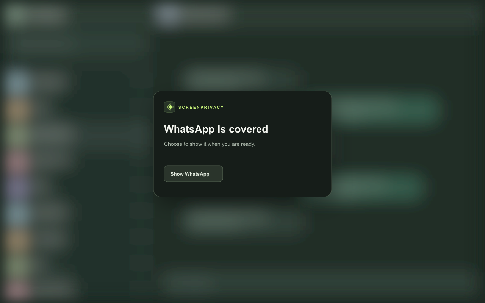
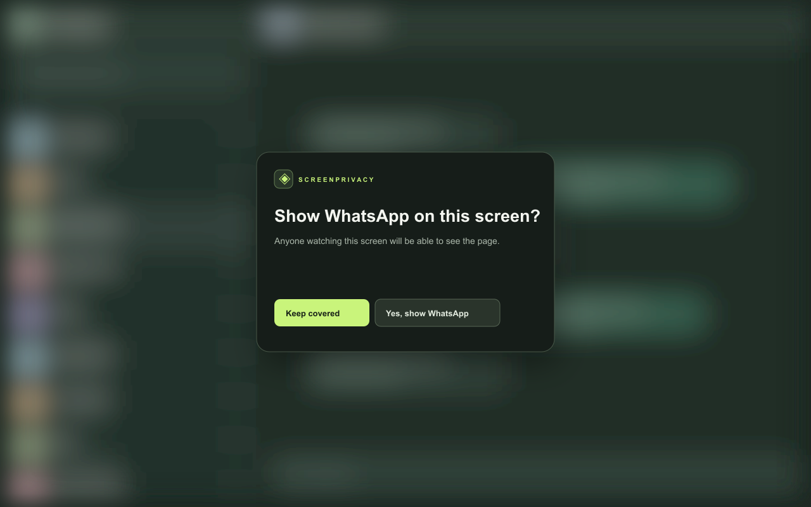

# Blur WhatsApp Chats

A privacy layer for WhatsApp Web when you work in shared spaces or share your screen.

*Fictional demo. No real conversations are shown.*

**Chrome Web Store status:** Submitted for review. The install link will be added here after Google publishes the extension.

## What it does

- Blurs chat names, previews, profile photos, messages, media, and the open chat title.
- Covers the entire WhatsApp Web page with the real page blurred behind a clear confirmation card. You choose when to reveal it.
- Lets you always blur or hide selected chats.
- Offers adjustable blur and reveal behavior, a toolbar toggle, an optional visual PIN cover, and idle or scheduled protection.
- Runs locally with no analytics or developer server.

*Fictional demo of selective blur.*

## How to use it after release

1. Install **Blur WhatsApp Chats** from the Chrome Web Store.
2. Open or reload [WhatsApp Web](https://web.whatsapp.com/).
3. Use the toolbar popup to choose what to blur. Select **Cover WhatsApp now** before sharing your whole screen.
4. Use the controls in an open chat to always blur or hide that chat.

## Privacy and limits

The extension does not store message text or media. Selected chat display titles and a salted hash of an optional PIN stay in browser local storage; Chrome Sync may synchronize visual settings if enabled. The PIN cover is a visual screen cover, not encryption. The extension does not hide desktop notifications or content in other apps. It cannot reliably detect a meeting or screen share outside WhatsApp Web.

Read the [privacy policy](PRIVACY.md). For help or feedback, contact **sujeetharigela14@gmail.com**.

Blur WhatsApp Chats is independent of WhatsApp and Meta. It is not affiliated with, endorsed by, or sponsored by them.
